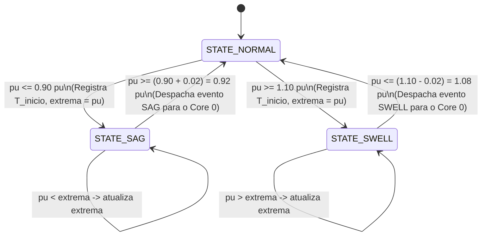

# Arquitetura Desacoplada - Monitor de Qualidade de Energia (Multi-ESP32 + Servidor Python :3000)

Este documento detalha os fundamentos de engenharia, a divisão de tarefas FreeRTOS entre os núcleos do ESP32 e a arquitetura distribuída cliente-servidor com o backend central em Python.

---

## 1. Visão Geral da Arquitetura Distribuída

O sistema opera de forma desacoplada: múltiplas sondas ESP32 atuam como nós de aquisição e processamento de borda (*Edge DSP*), enquanto um servidor central em Python ingere a telemetria na porta 3000 e fornece uma interface de monitoramento unificada.

```
┌────────────────────────────────────────────────────────┐       ┌────────────────────────────────────────────────────────┐
│                   ESP32 (Sonda 01)                     │       │                   ESP32 (Sonda N)                      │
│                                                        │       │                                                        │
│  [Core 1: DSP @ 3840 Hz]   [Core 0: WS Client]         │       │  [Core 1: DSP @ 3840 Hz]   [Core 0: WS Client]         │
│  - 64 amostras/ciclo 60Hz  - Enfileiramento            │       │  - 64 amostras/ciclo 60Hz  - Enfileiramento            │
│  - True RMS & pu           - JSON Encoder              │       │  - True RMS & pu           - JSON Encoder              │
│  - Máquina IEC 61000-4-30  - wsClient                  │       │  - Máquina IEC 61000-4-30  - wsClient                  │
└─────────────────────────────┬──────────────────────────┘       └─────────────────────────────┬──────────────────────────┘
                              │                                                                │
                              │ ws://<SERVER_IP>:3000/ws/device?device_id=ESP32-01             │ ws://...
                              ▼                                                                ▼
                     ┌──────────────────────────────────────────────────────────────────────────────────┐
                     │                           SERVIDOR CENTRAL PYTHON                                │
                     │                                (FastAPI :3000)                                   │
                     │                                                                                  │
                     │  - Ingestão WebSocket Multi-Sonda (/ws/device)                                   │
                     │  - Roteamento e Registro de Dispositivos                                         │
                     │  - Histórico Centralizado de Eventos em RAM                                      │
                     │  - Endpoints REST (/api/devices, /api/devices/{id}/config)                       │
                     │  - WebSocket de Distribuição UI (/ws/ui)                                         │
                     └────────────────────────────────────────┬─────────────────────────────────────────┘
                                                              │
                                                              │ WebSocket (/ws/ui) + HTTP (:3000)
                                                              ▼
                                             ┌───────────────────────────────────┐
                                             │      DASHBOARD WEB INDUSTRIAL     │
                                             │  - Seletor Dinâmico de Sondas     │
                                             │  - Gráfico Envelope Canvas        │
                                             │  - Cards Reativos (Normal/Sag/Sw) │
                                             │  - Tabela Consolidada & Export CSV│
                                             └───────────────────────────────────┘
```

---

## 2. DSP & Aquisição Analógica no ESP32 (Core 1)

### 2.1 Taxa de Amostragem e Temporização
- **Frequência Nominal:** $f_{rede} = 60\text{ Hz}$
- **Período da Rede:** $T_{ciclo} \approx 16.6667\text{ ms} = 16666.7\,\mu\text{s}$
- **Amostras por Ciclo:** $N = 64$ amostras
- **Frequência de Amostragem:** $f_s = 64 \times 60 = 3840\text{ Hz}$
- **Intervalo:** $\Delta t_s \approx 260.417\,\mu\text{s}$

A temporização do Core 1 é gerenciada por `esp_timer_get_time()`, mantendo jitter inferior a $1\,\mu\text{s}$.

### 2.2 Remoção de Offset DC e Cálculo True RMS
A polarização DC ($\approx 1.65\text{V} \approx 2048\text{ LSB}$) é removida ciclo a ciclo:

$$\mu_{DC} = \frac{1}{N} \sum_{k=0}^{N-1} v_{ADC}[k]$$

$$v_{AC}[k] = v_{ADC}[k] - \mu_{DC}$$

$$V_{RMS(raw)} = \sqrt{\frac{1}{N} \sum_{k=0}^{N-1} (v_{AC}[k])^2}$$

$$V_{RMS} = V_{RMS(raw)} \times K_{cal} \quad \Longrightarrow \quad pu = \frac{V_{RMS}}{V_{ref}}$$

---

## 3. Máquina de Estados IEC 61000-4-30

- **Limiar de Sag ($L_{sag}$):** $\le 0.90\text{ pu}$ (padrão)
- **Limiar de Swell ($L_{swell}$):** $\ge 1.10\text{ pu}$ (padrão)
- **Histerese ($H$):** $0.02\text{ pu}$ (padrão)



---

## 4. Comunicação Inter-Core (ESP32)

1. **`telemetryQueue`:** Fila de 1 elemento usando `xQueueOverwrite()`. Core 1 atualiza a cada 6 ciclos (~10 Hz). Core 0 consome e transmite sem bloquear.
2. **`eventQueue`:** Fila FIFO com capacidade para 32 eventos IEC 61000-4-30.
3. **`configMutex`:** Protege $V_{ref}$, $L_{sag}$, $L_{swell}$ e $H$ contra race conditions.
