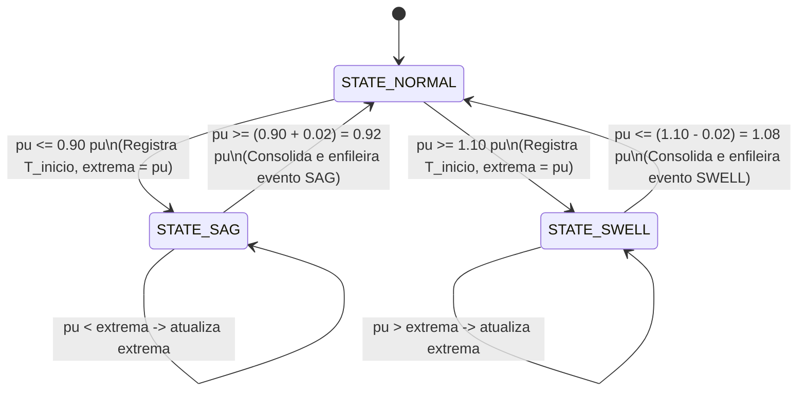

# Arquitetura do Sistema - Monitor de Qualidade de Energia (PQ-ESP32)

Este documento detalha os fundamentos de engenharia, a divisão de tarefas FreeRTOS entre os núcleos e a implementação dos requisitos da norma **IEC 61000-4-30** para detecção de Afundamentos (*Sag*) e Elevações (*Swell*) de tensão em redes de 60 Hz.

---

## 1. Visão Geral da Arquitetura Dual-Core

O ESP32 possui dois núcleos de processamento Xtensa LX6 operando a 240 MHz. Para garantir conformidade com requisitos industriais e de tempo real rígido (*hard real-time*):

```
+-----------------------------------------------------------------------------------+
|                                     ESP32                                         |
|                                                                                   |
|  +--------------------------------+       +------------------------------------+  |
|  |     CORE 1 (DSP & Aquisição)   |       |    CORE 0 (Comunicação & Web)      |  |
|  |       Prioridade Máxima (24)   |       |        Prioridade Baixa (2)        |  |
|  +--------------------------------+       +------------------------------------+  |
|  |                                |       |                                    |  |
|  | - Timer Pacing: 3840 Hz        |       | - Pilha Wi-Fi (SoftAP / STA)       |  |
|  |   (64 amostras / ciclo 60 Hz)  |       | - Servidor HTTP Assíncrono         |  |
|  | - Amostragem ADC (GPIO 34)     |       | - WebSocket Server (/ws @ 10 Hz)   |  |
|  | - Remoção Dinâmica de Offset DC|       | - Endpoints REST (/api/*)          |  |
|  | - Cálculo True RMS por ciclo   |       | - LittleFS + PROGMEM Fallback      |  |
|  | - Conversão por Unidade (pu)   |       | - Ring Buffer de Histórico         |  |
|  | - Máquina de Estados Histerese |       +------------------------------------+  |
|  +--------------------------------+                         ^                     |
|                  |                                          |                     |
|                  |   xQueueOverwrite (Telemetry: 1 slot)    |                     |
|                  +------------------------------------------+                     |
|                  |                                          |                     |
|                  |   xQueueSend (Events: 32 slots buffer)   |                     |
|                  +------------------------------------------+                     |
|                                                                                   |
+-----------------------------------------------------------------------------------+
```

---

## 2. DSP & Aquisição Analógica (Core 1)

### 2.1 Taxa de Amostragem e Temporização
- **Frequência Nominal da Rede:** $f_{rede} = 60\text{ Hz}$
- **Período da Rede:** $T_{ciclo} = \frac{1}{60} \approx 16.6667\text{ ms} = 16666.7\,\mu\text{s}$
- **Amostras por Ciclo:** $N = 64$ amostras
- **Frequência de Amostragem:** $f_s = 64 \times 60 = 3840\text{ Hz}$
- **Intervalo de Amostragem:** $\Delta t_s = \frac{16666.7\,\mu\text{s}}{64} \approx 260.417\,\mu\text{s}$

A temporização no Core 1 utiliza o registrador de microssegundos de alta resolução `esp_timer_get_time()`, garantindo precisão determinística e jitter desprezível (< $1\,\mu\text{s}$).

### 2.2 Remoção de Offset DC e Cálculo True RMS
Sinais provenientes de transformadores de potencial (ex: ZMPT101B) ou divisores resistivos possuem polarização DC no ponto médio do ADC ($V_{DC} \approx 1.65\text{V} \approx 2048\text{ LSB}$). A remoção ocorre dinamicamente a cada ciclo de 64 amostras:

$$\mu_{DC} = \frac{1}{N} \sum_{k=0}^{N-1} v_{ADC}[k]$$

$$v_{AC}[k] = v_{ADC}[k] - \mu_{DC}$$

O valor eficaz (*True RMS*) é extraído da componente puramente alternada:

$$V_{RMS(raw)} = \sqrt{\frac{1}{N} \sum_{k=0}^{N-1} (v_{AC}[k])^2}$$

$$V_{RMS} = V_{RMS(raw)} \times K_{cal}$$

$$pu = \frac{V_{RMS}}{V_{ref}}$$

Onde $V_{ref} = 127.0\text{ V}$ (padrão configurável via Web/API).

---

## 3. Máquina de Estados e Detecção IEC 61000-4-30

A norma IEC 61000-4-30 especifica que eventos de afundamento (*dip/sag*) e elevação (*swell*) devem utilizar histerese para evitar oscilações espúrias nas transições:

- **Limiar de Sag ($L_{sag}$):** $\le 0.90\text{ pu}$ (padrão)
- **Limiar de Swell ($L_{swell}$):** $\ge 1.10\text{ pu}$ (padrão)
- **Histerese ($H$):** $0.02\text{ pu}$ (padrão)

### Diagrama de Transição de Estados



---

## 4. Comunicação Thread-Safe entre Núcleos

Para evitar *race conditions* sem degradar a performance do Core 1:
1. **Fila de Telemetria (`telemetryQueue`):** Fila de tamanho 1 que utiliza `xQueueOverwrite()`. Core 1 atualiza a cada 6 ciclos (~10 Hz). Core 0 lê quando estiver pronto; não há acúmulo nem bloqueio.
2. **Fila de Eventos (`eventQueue`):** Fila FIFO com profundidade de 32 elementos. Quando um Sag ou Swell é concluído, o Core 1 despacha o registro com `xQueueSend(..., 0)`.
3. **Mutex de Configuração (`configMutex`):** Protege leituras e escritas das variáveis de limiar ($V_{ref}$, $L_{sag}$, $L_{swell}$, $H$) com tempos de espera inferiores a 5 ms.

---

## 5. Endpoints REST da API

| Método | Endpoint | Descrição |
|---|---|---|
| `GET` | `/` | Retorna o dashboard web interativo (LittleFS ou PROGMEM) |
| `GET` | `/api/config` | Retorna a configuração atual dos limiares em JSON |
| `POST` | `/api/config` | Atualiza dinamicamente $V_{ref}$, limiares e histerese |
| `GET` | `/api/events` | Retorna o histórico consolidado dos últimos 64 eventos |
| `POST` | `/api/events/clear` | Limpa o histórico de eventos armazenado em RAM |
| `POST` | `/api/simulate` | Dispara cenários de teste simulados (Nominal, Sag, Swell, ADC) |
| `WS` | `/ws` | Canal WebSocket bidirecional para telemetria contínua a 10 Hz |
